<div align="center">

# sdlc-kit

**Ship features with AI agents without burning tokens: plan → code → QA → ship, in 10 slash commands.**

[](https://www.npmjs.com/package/sdlc-kit)
[](https://github.com/sumitroajiprabowo/sdlc-kit/actions/workflows/ci.yml)
[](LICENSE)
[](package.json)




`npx sdlc-kit` · works with Claude Code, Codex, Antigravity, Cursor, OpenCode and local LLMs

⭐ If this saves you tokens, a star helps others find it.

</div>

Skills, slash commands, and a multi-agent handoff protocol for an end-to-end SDLC (plan, code, QA, ship, incident response). Installs into Claude Code, Codex, Antigravity, Cursor, OpenCode, or any local LLM. TypeScript, no runtime dependencies.

## Why

Long sessions, bloated global instructions, full test logs, and whole chat histories passed between subagents all burn tokens. This package keeps the always-loaded part small and moves the detail into files that load only when needed:

- **Small baseline**: each skill loads only its YAML frontmatter up front; the full playbook and its 8 `references/` load when the task calls for them. Slash commands load their one-line description until you invoke them.
- **2 subagents** (Claude Code): `sdlc-reviewer` and `sdlc-tester`, independent read-only review and QA used by size M/L tasks.
- **10 slash commands**: `/sdlc-spec`, `/sdlc-start`, `/sdlc-handoff`, `/sdlc-pickup`, `/sdlc-handoff-pr`, `/sdlc-adr`, `/sdlc-qa`, `/sdlc-review`, `/sdlc-ship`, `/sdlc-start-orchestration`.
- **Covers repo setup to production**: milestone slicing, 5-state frontend checklist, QA pyramid, bugfix vs production hotfix, CI/CD, and Expand & Contract database migrations.
- **Size routing, spec gates, and resumable state**: `/sdlc-start` classifies tasks as S/M/L, `/sdlc-spec` pauses at an explicit approval gate before issue breakdown, and `.claude/HANDOFF.md` (`Task | Stage | Size`) plus gitignored `.claude/tasks/<slug>/` artifacts resume cleanly across `/clear`.
- **Orchestrator protocol**: fresh-context worker briefings and worker reports under 30 lines.

---

## Quick Start

```bash
# Auto-detect installed agents on your machine
npx sdlc-kit
```

The package is published on npm as [`sdlc-kit`](https://www.npmjs.com/package/sdlc-kit), with provenance, from this repository's CI. To run straight from GitHub instead: `npx github:sumitroajiprabowo/sdlc-kit`.

### Install for Specific Agents

```bash
# Claude Code only (skills + 10 slash commands + 2 subagents)
npx sdlc-kit --claude

# Claude Code + token-saving preset: adds opusplan (only if you have no model set),
# 200k context cap, tool search, auto-compact, and a statusline (ctx %, cost, tokens). Existing values are kept.
npx sdlc-kit --claude --optimize

# Codex only
npx sdlc-kit --codex

# Antigravity (skills + 10 slash commands)
npx sdlc-kit --antigravity

# Cursor or OpenCode (skills + 10 slash commands)
npx sdlc-kit --cursor
npx sdlc-kit --opencode

# Local LLMs (Ollama / OpenCode / Aider / Cline) -> <800-token prompt
npx sdlc-kit --local

# Scaffold a project repository (docs/INDEX.md, ADR template, PR template, AGENTS.md + CLAUDE.md bridge, .gitignore)
npx sdlc-kit --project

# Run a read-only health & token-efficiency audit
npx sdlc-kit --doctor

# Install to all agents at once
npx sdlc-kit --all
```

### Alternative Install Methods

```bash
# Via skills CLI
npx skills add sumitroajiprabowo/sdlc-kit

# Via Claude Code plugin marketplace
/plugin marketplace add sumitroajiprabowo/sdlc-kit
/plugin install sdlc-kit@sdlc-kit
```

> Formerly `agent-sdlc`. Installs made with 0.1.0 are migrated automatically the next time you run `sdlc-kit`. If you installed the Claude plugin, reinstall it under the new name.

---

## CLI Options

| Flag | Description |
|---|---|
| `--claude` | Install skills, 10 slash commands & 2 subagents into `~/.claude/` |
| `--codex` | Install skills into `~/.agents/skills/` and the 10 commands as explicit-only skills in `~/.codex/skills/` |
| `--antigravity` | Install skills into `~/.agents/skills/` and the 10 commands as explicit-only skills in `~/.gemini/config/skills/` |
| `--cursor` | Install skills into `~/.cursor/skills/` and commands into `~/.cursor/commands/` |
| `--opencode` | Install skills into `~/.agents/skills/` and commands into `~/.config/opencode/commands/` |
| `--local` | Install a compact prompt (`<800` tokens) to `~/.sdlc-kit/LOCAL_PROMPT.md` |
| `--project` | Scaffold non-destructive project templates (`docs/`, PR template, `AGENTS.md`, `CLAUDE.md -> @AGENTS.md`, `.gitignore`) |
| `--all` | Install across `claude`, `codex`, `antigravity`, `cursor`, `opencode`, and `local` |
| `--optimize` | With `--claude`: backs up `~/.claude/settings.json` (the original `.bak` is never overwritten), then adds only the keys you haven't set: `opusplan` model, 200k context cap, tool search, auto-compact at 70%, bounded outputs, and a statusline showing context %, session cost, and token counts. Run `--claude --uninstall` to revert just those keys |
| `--doctor` | Run a read-only health & token-efficiency audit |
| `--no-orchestrator` | Skip installing `sdlc-orchestrator` (single-agent workflow only) |
| `--dry-run` | Preview actions without writing any files |
| `--force` | Overwrite or remove files even if they were not installed (or were edited after install) |
| `--uninstall` | Remove only files `sdlc-kit` installed and you haven't edited; reverts the settings `--optimize` added |

---

## Daily Developer Workflow

```text
[0] Repo Setup   -> Thin AGENTS.md/CLAUDE.md (<4 KB) + docs/INDEX.md + path-scoped rules
[1] Plan         -> /sdlc-spec (big features, approval gate) -> /sdlc-start #123 (size S/M/L; 1 Issue = 1 PR)
[2] Code         -> Planner designs -> Executor codes + targeted tests
[3] Handoff      -> ctx >=70%: /sdlc-handoff -> /clear -> /sdlc-pickup   (team: /sdlc-handoff-pr)
                    HANDOFF.md keeps `Task | Stage | Size`; artifacts live in .claude/tasks/<slug>/
[4] Ship & QA    -> (S: tests only) /sdlc-qa -> /sdlc-review -> /sdlc-ship -> CI gate -> SemVer release -> Prod
[5] Incident     -> Bug: fix/#id + regression test | Prod outage: hotfix/ from tag, minimal diff, back-merge
```

### Usage by Agent

- **Claude Code**: Use `/sdlc-spec` (for big features), `/sdlc-start #123`, `/sdlc-handoff`, `/sdlc-pickup`, `/sdlc-handoff-pr`, `/sdlc-adr`, `/sdlc-qa`, `/sdlc-review`, `/sdlc-ship` directly. Task state is saved in `.claude/HANDOFF.md` and `.claude/tasks/<slug>/`. With `--optimize`, press `Shift+Tab` twice for Plan Mode (Opus) and approve to execute on Sonnet (`opusplan`).
- **Codex**: Run the 10 commands as skills: `$sdlc-start #123`, `$sdlc-spec`, `$sdlc-ship`, and so on (Codex removed custom prompts, so `/prompts:` no longer works). They load only when invoked. `$sdlc-workflow` and `$sdlc-orchestrator` are also available.
- **Antigravity**: Skills in `~/.agents/skills/` are discovered automatically; reference `sdlc-workflow` during `/plan` or `sdlc-orchestrator` for `/swarm` and subagents. The 10 commands (`/sdlc-start #123`, `/sdlc-spec`, ...) are explicit-only skills in `~/.gemini/config/skills/` and load only when invoked.
- **Cursor**: Skills in `~/.cursor/skills/` are discovered automatically and the 10 commands are available from `~/.cursor/commands/`.
- **OpenCode**: Skills in `~/.agents/skills/` are discovered automatically; the 10 commands are in `~/.config/opencode/commands/`.
- **Local LLMs**: Load `~/.sdlc-kit/LOCAL_PROMPT.md` as your system prompt or project instruction.

---

## Multi-model team

Run each SDLC role on its own CLI and model across isolated git worktrees:

| Role | CLI | Model |
|---|---|---|
| `tech-lead` | `claude` | `claude-opus-5-5` |
| `backend` | `agy` | `gemini-4-neon-medium` |
| `frontend` | `codex` | `gpt-6.2-sol` |
| `mobile` | `agy` | `gemini-4-neon-medium` |
| `qa` | `opencode` | `opencode/deepseek-v4.1-flash-free` |

```bash
/sdlc-start-orchestration setup
/sdlc-start-orchestration "<task>"
```

Configs live in global `~/.sdlc-kit/team.json` and per-project `.sdlc/team.json` (overrides per role). See [team-dispatch.md](skills/sdlc-orchestrator/references/team-dispatch.md) for the full role catalog and headless invocations.

Roles communicate only through the lead via `.claude/tasks/<slug>/board.md` and shared `contracts/` (such as `api.md`, `events.md`, `schema.md`).
Built-in workflows (`feature`, `bugfix`) run agent, script, and human `gate` steps in dependency order, pausing at gates to approve, rerun with context, or send back to an earlier step.
Run state is saved in `run.json`, so an interrupted run can continue with `/sdlc-start-orchestration resume <slug>`.
Override or add project workflows in `.sdlc/workflows/<name>.json` and run them with `workflow=<name>`.
Before `gate-design`, a parallel `design-review` panel critiques `contracts/api.md` using bounded debate threads, a strict message enum, and non-blocking `DISSENT` surfaced at gates (see [team-debate.md](skills/sdlc-orchestrator/references/team-debate.md)).
Roles keep a per-run session in `run.json` so peer `QUESTION`/`OBJECTION` threads resume live instead of waiting for the next wave.
See [team-protocol.md](skills/sdlc-orchestrator/references/team-protocol.md) for the board format, routing rules, and workflow schema.

---

## Included Playbooks & Docs

- **[sdlc-workflow](skills/sdlc-workflow/SKILL.md)** — 0 → Production SDLC playbook with 9 on-demand references:
  - [architecture-checklist.md](skills/sdlc-workflow/references/architecture-checklist.md) — Idempotency, failure design, backward compatibility, data integrity
  - [monolith-and-microservices.md](skills/sdlc-workflow/references/monolith-and-microservices.md) — Modular monolith boundaries, service extraction, outbox, tracing, sagas
  - [clean-code.md](skills/sdlc-workflow/references/clean-code.md) — Coding discipline, layer boundaries, error handling, simplicity
  - [quality-gates.md](skills/sdlc-workflow/references/quality-gates.md) — Auto-detect format, lint, vulncheck, secret scan, API QA & load/stress testing
  - [security-checklist.md](skills/sdlc-workflow/references/security-checklist.md) — Multi-tenant isolation, session hygiene, OWASP, PII masking, audit logs
  - [ai-security-checklist.md](skills/sdlc-workflow/references/ai-security-checklist.md) — LLM/agent security: OWASP LLM & Agentic Top 10, prompt injection, guardrails, red teaming, model supply chain
  - [database-hygiene.md](skills/sdlc-workflow/references/database-hygiene.md) — Query plans, lock-safe migrations, pooling, short transactions, backups
  - [incident-response.md](skills/sdlc-workflow/references/incident-response.md) — SEV1–SEV4 tiers, 5-minute mitigation rule, comms, post-mortems
  - [developer-habits.md](skills/sdlc-workflow/references/developer-habits.md) — Observability, blameless post-mortems, code deletion, tech debt budget, DoD
- **[sdlc-orchestrator](skills/sdlc-orchestrator/SKILL.md)** — Token-safe multi-agent briefing & handoff protocol
- **[CHANGELOG.md](CHANGELOG.md)** & **[CONTRIBUTING.md](CONTRIBUTING.md)**

---

## What gets installed

| Target | Skills | Slash commands |
|---|---|---|
| `--claude` | `~/.claude/skills/` | `~/.claude/commands/` (+ subagents in `~/.claude/agents/`) |
| `--codex` | `~/.agents/skills/` | `~/.codex/skills/sdlc-*/` (invoke as `$sdlc-start`) |
| `--antigravity` | `~/.agents/skills/` | `~/.gemini/config/skills/sdlc-*/` (invoke as `/sdlc-start`) |
| `--cursor` | `~/.cursor/skills/` | `~/.cursor/commands/` |
| `--opencode` | `~/.agents/skills/` | `~/.config/opencode/commands/` |
| `--local` | `~/.sdlc-kit/LOCAL_PROMPT.md` | none |

Every installed file is recorded with a hash in `~/.sdlc-kit/manifest.json`. The installer skips files it didn't create, and `--uninstall` removes only files that are unchanged since install.

## Troubleshooting

- **"Skipped ... not installed by sdlc-kit"**: a file with that name already exists (e.g. your own `review.md`). Keep it, rename ours, or pass `--force` to overwrite.
- **Slash command name clashes**: every command carries the `sdlc-` prefix so it cannot collide with built-ins such as `/ship` or `/review` (a test enforces this). Installed commands never overwrite existing files. Old unprefixed commands (`/ship`, `/review`, ...) installed by 0.1.x are removed automatically on upgrade if you never edited them; edited ones are kept with a warning. Plugin installs are namespaced (`/sdlc-kit:sdlc-review`).
- **Task files show up in git**: `.claude/tasks/` and `.claude/HANDOFF.md` are local state. `--project` adds both to `.gitignore` and `--doctor` warns if either is missing.
- **Skills load twice**: you have both the Claude plugin and `npx --claude`. `--doctor` flags this; remove one with `npx sdlc-kit --claude --uninstall`.
- **Uninstall left a file**: it was edited after install. Delete it manually or use `--uninstall --force`.
- **Windows, macOS, Linux**: all three are tested in CI on Node 20 and 22. The installer and the `--optimize` statusline need only Node.js (no `bash` or `jq`). Paths use your home directory (`%USERPROFILE%` on Windows). The Cursor and OpenCode directories are unverified on Windows.
- **Requires Node.js >=20.**

## Verifying the token savings yourself

No benchmark numbers are published; measure on your own setup. In Claude Code run `/context` in a fresh session before and after `npx sdlc-kit --claude` and compare the "Skills" and "Slash commands" rows (only frontmatter loads up-front). Run `npx sdlc-kit --doctor` for a baseline audit.

## Development & Tests

```bash
npm test                       # Node >=20, runs in temp dirs only
node dist/bin/cli.js --dry-run --all   # after `npm ci && npm run build`; previews an install without writing
```

See [CONTRIBUTING.md](CONTRIBUTING.md) before opening a PR.

## License

MIT
